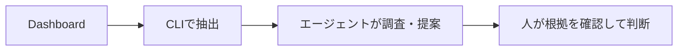

# ロードマップの要点

このページは[英語版ロードマップ](ROADMAP.md)の要約です。細かな設計条件や調査記録へのリンクは英語版を参照してください。
2026年11月11日時点の実装と公開資料をもとにしています。将来の機能や公開時期を約束するものではありません。

## 目指すこと

renodashは、依存パッケージの更新を調べるための根拠を、確認しやすい形で扱うツールを目指します。
根拠には、Dashboardの記述、公開リリース情報、出典、取得時刻などを含みます。

役割は次のように分けます。

- CLIは、対応するDashboardの情報を抽出し、出典や不明点をJSONで示します。
- エージェントは、公開資料や利用側のコードを調べ、変更の影響と次の行動を提案します。
- 人は、重要な根拠と前提を確認し、更新するかどうかを決めます。
- Renovateは、依存関係の検出、更新の作成、承認待ち、更新PRの作成を担います。

エージェントが使いやすく、人も根拠を確認できる設計にします。通常のCLI操作にLLMは必要ありません。
根拠を正確に扱うことと、更新の安全性を保証することは別です。

## 今できること

| コマンド・機能 | できること | 注意点 |
| --- | --- | --- |
| `parse` | 保存したDashboardのMarkdownをJSONに変換する | オフラインで動く。入力元のURLと取得時刻は利用側で記録する |
| `get` | `gh api`で指定したGitHub Issueを取得し、JSONに変換する | 取得時刻とIssueの更新時刻を分けて記録する |
| 更新候補の抽出 | 更新候補、一括操作、チェック状態、対応するPRリンクを取り出す | 操作は実行しない。PRの現在の状態も確認しない |
| 調査用の情報 | 単一パッケージや、名前が明記されたグループの情報を取り出す | 名前の一致だけでは、実際のブランチ内容や導入済みパッケージを証明できない |
| `version` | 取得できるビルド情報を表示する | コミットSHAがない場合や、SHAだけではソースの変更を追えない場合がある |

外部のリリース情報を収集する機能、キャッシュ、保存結果の再生コマンド、公開プラグインAPIは、まだありません。
既存JSONの形式は維持します。将来、外部情報の形式が必要になっても、既存の`research`を別用途に使い回しません。

## 次に試すこと

機能を増やす前に、既存CLIとエージェントで概念実証（PoC）を行います。

1. まだ調査したことのない更新候補を選び、公式リリース情報などを調べる。
2. 出典、公開時刻、取得時刻、CLIのバージョン、不明点を記録する。
3. 人が手作業で調べた場合と比べ、調査の手間が減るか、根拠を確認しやすいかを確かめる。
4. 独立した複数のPoCを比べ、繰り返し必要になる処理を探す。

たとえば、GitHub Releaseの公開時刻と、コンテナイメージの公開時刻は別です。
ログがなくて原因を確認できない場合は、推測で埋めず、不明と記録します。

## CLIに機能を追加する条件

エージェントのスキルで試し、次の条件を満たす処理だけをCLIへの追加候補にします。

- 独立した複数のPoCで、繰り返し必要になる。
- 入力と出力が明確で、同じ保存済み入力と処理条件から同じ結果を得られる。
- エージェントの判断に頼らずテストでき、曖昧さや失敗を明示できる。
- renodashの責務に合い、スキルに残す場合より実用上の利点がある。

同じ結果が出るだけでは、追加する理由になりません。
外部情報の取得や利用環境に応じた判断は、繰り返し必要でもスキル側に残す場合があります。

## 根拠の扱いで守ること

事実、機械的に確認できる兆候、評価、推奨を分けます。
たとえば「公式資料にAPI廃止と書いてある」は出典付きの事実です。
「自分のコードに影響する」は利用環境に応じた評価、「今すぐ更新する」は推奨です。
CLIの出力は、事実と、根拠が明確で再現可能な兆候に限ります。

### 再現には2つの意味がある

- Dashboardの抽出結果を再現するには、入力、CLIの識別情報、処理条件を残す。
- 外部資料に基づく結論を再確認するには、資料のリビジョンや保存した内容が必要になる場合がある。

公開資料は後から変わるため、URLと取得時刻だけでは当時の内容を再現できません。
ハッシュは内容の一致を確かめる手段であり、失われた内容を復元したり、正しさを保証したりするものではありません。
保存や再生の仕組みを作るかどうかは、PoCで必要性を確かめてから決めます。

### 不明・失敗・古い情報を隠さない

- 「該当なし」と「取得失敗」「一部だけ取得」「未対応」を分ける。
- 値がない場合は、情報源にない、未確認、対応関係が不明などの理由を残す。
- 資料同士が矛盾する場合は、出典と時刻を添えて両方を残す。
- キャッシュから読んでも元の取得時刻を更新せず、古い情報だと分かるようにする。

### 非公開情報を公開しない

`get`は、認証済みの`gh`で読める非公開Issueも取得できます。`parse`と`get`の出力には元の記述が残ります。
どちらも、秘密情報を検出・除去するツールではありません。

アクセス制限のある情報は、許可された環境内で扱い、明示的な許可なしに公開しません。
公開リリース情報と非公開の更新候補を結びつけた記録も、制限付きの情報です。
根拠を再現したい場合でも、この制限を優先します。外部資料はデータとして扱い、エージェントへの指示として実行しません。

## 対象にしないこと

- 脆弱性の検出・調査・評価。CVE調査、CVSSの解釈、Dependabot Alertsの管理、GHSA・OSV連携も含む。
- 更新の安全性の保証や、CLIによるセキュリティ上の優先順位づけ。
- 自動承認、チェックボックスの変更、更新PRの作成、変更の適用、マージ。
- 名前だけからの別名の対応づけ、グループの更新先、配布物の同一性の推定。
- Renovateの更新処理の作り直し。

### 公開資料で偶然見つけた記述

脆弱性調査は、将来へ延期する機能ではなく、製品スコープの対象外です。
通常の公開リリース資料で偶然見つけたセキュリティ関連の記述は、出典付きで記録できます。
ただし、専用の脆弱性検索や、深刻度・悪用可能性・利用環境への適用可能性・修正の確実性の判定は行いません。
記述がないことも、安全である根拠にはなりません。過去のセキュリティ調査は、履歴として保存します。

## まだ決めていないこと

公開情報の収集、保存、再生、キャッシュ、共有データ群、ルールエンジン、プラグインAPIは、実装を約束していません。
まず、どの処理に実用上の価値があるかをPoCで確かめます。

共有データ群を作るには、更新と訂正を続ける責任、出典、再配布の条件、非公開情報の保護も必要です。
公開されている資料でも、全文を自由に保存・再配布できるとは限りません。
Secretlintは、小さくテスト可能な処理と明確な責務分担の参考です。セキュリティ機能を取り込む計画ではありません。

## 実装済み：グループ更新の調査情報

v0.0.3で、名前が明記されたグループのパッケージ情報を`research.packages`に追加しました。
単一パッケージ向けの既存JSONは維持しています。

グループ内の名前とDashboardの依存情報を対応づけ、現在のバージョン、更新候補、管理ツール、ファイル情報を残します。
ただし、名前の一致はブランチの変更内容を証明しません。
更新候補は`available_updates`に残し、グループの更新先を特定できなければ`"unknown"`にします。
