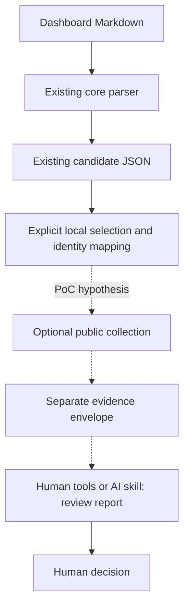

# Roadmap

[日本語の要点](ROADMAP.ja.md)

Reviewed against the implementation and public documentation on 2026-11-11. This is a proposal, not a release schedule or a claim that the features below exist.

## How to read this roadmap

- [Existing foundation](#existing-foundation-and-constraints): what the CLI already does.
- [Design principles](#design-principles-and-responsibilities): responsibilities and feature criteria.
- [PoC options](#poc-driven-development-options): ideas to test before implementation.
- [Privacy boundary](#security-and-privacy-boundary): restrictions on access and publication.
- [Non-goals](#explicit-non-goals): work outside the product scope.

## Vision and problem

> renodash should own evidence integrity, not decision authority.

renodash helps humans and AI agents investigate dependency update candidates by collecting, normalizing, and preserving verifiable evidence. Interpretation in a specific application's context belongs to agents and humans; final approval belongs to people. Evidence integrity means faithful representation, traceable sources, explicit limitations, and reproducible processing. It does not certify that an upstream claim is true or an update is safe.

The product hypothesis is that evidence attached to a candidate, including before an update PR exists, reduces investigation effort and makes decisions easier to review. Test this against real workflows before adding more sources. A justified decision to investigate further is a useful outcome.

### Status vocabulary

- **Existing:** implemented in the CLI or documented as a completed observation.
- **Constraint:** a limitation established by implementation or source documentation.
- **Proposed:** a recommended direction; implementation and interface details remain subject to review.
- **Open:** a question or hypothesis requiring evidence before commitment.

The earlier roadmap prioritized agent-led PoCs before CLI expansion. That validation is still required. This revision proposes an optional evidence collection boundary beyond Dashboard extraction; the CLI does not currently have that responsibility. External collection remains an agent workflow unless independent PoCs justify a CLI abstraction; the options below are hypotheses, not implementation commitments.

## Existing foundation and constraints

| Status | Capability or observation | Boundary and local evidence |
| --- | --- | --- |
| Existing | `parse` reads saved Markdown and produces JSON without network access | [Command handling](../internal/command/run.go), [parser](../internal/dashboard/parser.go), and [output reference](output-format.md) |
| Existing | `get` fetches one GitHub issue through `gh api` and adds source metadata | [Implementation](../internal/command/get.go) validates metadata, uses a 30-second timeout, and distinguishes fetch time from issue update time |
| Existing | Candidates, bulk controls, checkbox states, and Open-section PR links are extracted | Actions describe source controls; the CLI never executes them. PR links and current PR status are not verified |
| Existing | Unsupported controls in recognized sections are preserved with warnings | Unknown sections, comments, and code examples are excluded; this is not a complete representation of arbitrary Dashboard Markdown |
| Existing | Single-package and explicit group research context includes extraction provenance | [Research implementation](../internal/dashboard/research.go) matches exact names, preserves version expressions, and leaves group targets unresolved |
| Existing | Saved fixtures and tests cover extraction and command errors | [Fixture sources](../testdata/README.md), [parser tests](../internal/dashboard/parser_test.go), [research tests](../internal/dashboard/research_test.go), and [command tests](../internal/command/get_test.go) |
| Existing | `version` reports available build information | Missing SHA is possible; a dirty build's source changes are not captured by its SHA. See [development](development.md#build-information) |
| Constraint | Package identity and installed versions are not established | A manager such as `mise` does not establish package identity; a same-name record does not prove branch contents or the installed artifact |
| Constraint | No external evidence contract, provider, cache, snapshot replay command, public plugin API, or LLM integration exists | Code is under `internal/command` and `internal/dashboard`; there is no public Go library API or external Go module dependency |

Existing JSON uses `snake_case`, arrays including empty arrays, and source order within each array. Single-package and group `research` have different established shapes. Preserve these contracts; if PoCs justify an evidence envelope, version it separately instead of repurposing `research`. `parse` cannot know the source URL or fetch time of stdin. Consumers must record these separately today.

## Design principles and responsibilities

Keep the established **Agent-first, Human-verifiable** principle: agents are the primary intended consumers, interfaces are independent of any agent vendor, and humans can inspect evidence without trusting generated prose. Ordinary CLI operations require no LLM. The same evidence JSON must be usable directly by a human with standard tools; this does not require a separate human-facing product.

| Layer | Owns | Leaves outside its authority |
| --- | --- | --- |
| Core: existing extraction engine | Supported Dashboard parsing, predictable JSON, source associations, unsupported controls, deterministic processing of saved input | Network research, inferred aliases or group targets, security verdicts, repository changes |
| Evidence collection: hypothesis for PoCs | Explore public release information and provenance in agent workflows; move only justified operations into the CLI | Vulnerability intelligence, contextual judgment, or a commitment to collectors or storage |
| AI skills and human review: existing workflow, to evolve | Identify upstream and package mapping, inspect code usage and dependency relationships, verify actual diffs and artifacts, interpret breaking changes, migrations, compatibility, and deprecations, recommend validation and action | Unsourced claims or treating absent evidence as safety |
| Humans | Verify important evidence and assumptions, supply environmental context, authorize private context access, weigh trade-offs, make approval and update decisions | Implicitly delegating final authority through a collection command |
| Renovate | Dependency discovery, update generation and scheduling, Dashboard approval and update PR workflow | renodash consumes its context instead of duplicating its update engine |

Keep four output meanings separate:

| Meaning | Example |
| --- | --- |
| Source-attributed fact | Release notes state that an API is deprecated |
| Reproducible signal | A supported Dashboard group has an unresolved target, with extraction provenance |
| Assessment | A breaking API change affects a call site in the target repository |
| Recommendation | Update now, postpone, or investigate further given operational tradeoffs |

Only facts and justified deterministic signals belong in CLI output. Security-specific investigation is not a renodash product workflow. Agent interpretations belong in a separate report referencing evidence records, with author/tool, time, assumptions, and unresolved questions.

### From AI skills to CLI candidates

AI skills are the experimental environment for discovering useful abstractions. Consider moving an operation into the CLI only when it meets all these conditions:

- Independent PoCs repeatedly need the operation.
- Inputs and outputs are specified.
- Behavior is deterministic and independently testable.
- Ambiguity and failure cases are explicit.
- The operation fits renodash's core responsibility.
- Implementation offers meaningful practical benefits over leaving it in a skill.

Determinism alone is insufficient; no numerical threshold decides this.

Candidates might include Dashboard metadata extraction and normalization, source-reference preservation, explicit ambiguous candidates, or repetitive transformations of supported Dashboard input. External retrieval, contextual investigation, and decisions may remain in agent workflows even when repeated. Actual PoC findings determine the abstraction.

### Intentional vulnerability intelligence exclusions

Vulnerability intelligence and security assessment are outside the product scope, not postponed features. Exclusions include:

- CVE tracking and investigation.
- CVSS score and severity calculation or interpretation.
- Dependabot Alerts retrieval and management.
- GHSA/OSV database integration.
- Applicability verification and exploitability assessment.
- Security risk scoring, prioritization, and vulnerability intelligence corpora.
- Security scanners, vulnerability providers, security plugins, rule engines, and security-specific commands.

Specialized tools own these responsibilities; renodash does not replace or compete with Dependabot or Secretlint.

### Incidental statements in public release documentation

During ordinary update research, an agent may incidentally encounter a security-fix statement, CVE reference, or security-related behavior change in public release notes, changelogs, or migration guides. Record only what that source states, with attribution. Do not proactively query vulnerability databases, conduct dedicated CVE/GHSA/OSV investigations, verify applicability, or infer exploitability or severity. A reference does not establish a verified security fix, and absence of security information does not establish safety. This exception does not allow security analysis.

## Precedents and source selection

### Secretlint: borrow boundaries, not features

[Secretlint](https://github.com/secretlint/secretlint) separates its engine from rule packages and offers recommended presets for adoption. Its evolution also illustrates [configuration validation](https://efcl.info/2022/03/08/secretlint-5/) and [default secret masking](https://github.com/secretlint/secretlint/releases/tag/v10.0.0).

The lessons are small independently testable rules, reproducible detection, explicit reasons for signals, false-positive management, and a small extensible core with clear input errors and safe diagnostics. These are architectural references, not adoption of Secretlint's security domain. Do not introduce a plugin framework or rule engine without demonstrated requirements.

### Renovate: reuse the workflow and existing information

The [Dependency Dashboard](https://docs.renovatebot.com/key-concepts/dashboard/) presents update state and supports approval before PR creation. Approval permits the workflow to proceed; it does not certify security. Renovate already [retrieves changelogs](https://docs.renovatebot.com/key-concepts/changelogs/). Reuse available release/dependency references and verify their origin instead of rebuilding PR enrichment.

Vulnerability alerts and related security workflows belong to Renovate and specialized security tools, outside renodash's product scope.

### Public evidence: authority depends on the claim

| Source | Suitable evidence | Limits to preserve |
| --- | --- | --- |
| Official releases, changelogs, migration guides, breaking-change docs | Upstream behavior changes and migration requirements | One release's notes do not cover every intervening release or backport |
| Official package registry metadata | Artifact identity, publication, withdrawal/deprecation metadata where supported | Registry artifacts, Git tags, GitHub Releases, and bundled dependencies are different subjects |
| Maintainer announcements and support/EOL policies | Attributed support and deprecation statements | Verify publisher, applicable release line, and date; informal posts may need confirmation |

These are sources for ordinary agent-led update research, not committed CLI integrations. Prefer the original publisher for what it actually states, and distributor-specific evidence for distributed artifacts. Do not assign a universal trust score or resolve disagreements by counting mirrors.

## Architecture hypothesis for PoCs



Solid extraction steps exist today. Dotted steps describe an optional collection boundary to test through PoCs.

This is a possible boundary to test only after recurring PoC findings justify collection in the CLI. It does not define an implementation plan. The parser must not import provider code. `parse` remains offline; `get` continues to fetch only the requested issue. Public collection is an explicit operation with a separate output envelope, not a side effect of either command. Command naming is open. Keep GitHub communication through `gh api` initially; no general GitHub client or framework is justified.

A provider receives only validated public lookup parameters and returns observations plus collection outcomes. It must not receive a Dashboard body, local file contents, or a whole private candidate. A local envelope can associate the result with the candidate; that association is not sent upstream. Normalization is deterministic for a saved response, provider version, and fixed collection metadata. Live retrieval cannot promise identical results over time.

Keep provider-specific code concrete and internal initially. With a justified second source, consider a small interface for request, result, diagnostics, and saved-response normalization. Dynamic loading, subprocess protocols, third-party Go compatibility, a marketplace, and a configuration language are deferred.

## Proposed evidence and provenance contract

Use this conceptual inventory to explore evidence needs in PoCs. It describes possible evidence fields rather than existing JSON or a frozen API. It does not require storage. If an envelope is justified, keep candidate, observation, and collection-outcome records separate and version it independently.

| Record | Required meaning |
| --- | --- |
| Envelope | Schema version, producer version/source SHA and dirty state when available, collection time, ordered observations and outcomes |
| Candidate reference, kept local | Input snapshot reference/hash, source URL and observation time when known, item locator including branch, package/group member and selected dependency record; branch alone is not a permanent ID |
| Subject and mapping | Original package/version expressions; ecosystem and package ID or unresolved state; current and target values; supplied upstream/tag or digest; mapping author and supporting evidence |
| Observation identity | Local evidence ID, category such as `release_metadata` or `deprecation_notice`, subject, provider name/version, source record ID and aliases |
| Source | Publisher and origin identity, authoritative record URL where established, retrieval endpoint, public/access-restricted classification, review status where relevant; a Dashboard link alone does not establish authority |
| Time | Separate source publication, modification, withdrawal, and retrieval times in RFC3339; unknown values have reasons |
| Applicability | Source-stated package identity, supported version ranges or release tag, range syntax/ecosystem, source field locations, and match status such as unresolved or source-reported match |
| Findings | Typed source-attributed fields and bounded excerpts with source pointers; optional reproducible signal with rule/version and limitations; no generated recommendation |
| Collection outcome | Requested scope, filters, completion state, pagination/truncation, errors, unsupported input, and reason codes; present even when no observations are returned |
| Replay material, when retained | Saved response reference/hash, capture metadata, normalizer version, and reuse rights; retention/export is explicit |

Preserve raw version expressions. Unknown ecosystems, aliases such as `node.js`/`node`, floating tags, digests, and unresolved group targets must not be coerced into SemVer queries. A potential collector could use explicitly supplied upstream references without proving package equivalence: label the mapping user-supplied and package applicability unverified. A universal version solver is out of scope.

### Two kinds of reproducibility

#### Dashboard extraction replay

Preserve these inputs to support deterministic extraction replay:

- Dashboard input.
- CLI/build identity, including source changes when relevant.
- Fixed processing metadata.

#### Conclusions based on external sources

Public changelogs and release notes may change after publication. URLs and retrieval timestamps alone do not guarantee reproduction of a conclusion's evidence basis.
Depending on the source, preservation may require:

- Source revisions or commit SHAs.
- Content hashes and immutable evidence snapshots, where appropriate.
- Processing metadata.

A hash identifies bytes but does not recover missing content or establish truth. Replaying evidence does not guarantee the same contextual judgment.
Storage, hashing, archival, and snapshot mechanisms remain future PoC design questions, not requirements for the current CLI or this PR.

### Missing, conflicting, and stale information

- Distinguish `complete`, `partial`, `failed`, and `unsupported` collection outcomes. A complete empty query means only that the selected source returned no results for that scope at that time. Timeouts or incomplete pagination must not become empty success.
- Give missing values reasons such as `not_provided_by_source`, `not_observed`, `not_applicable`, or `unverified_mapping`. Avoid bare `null` and uncalibrated numeric confidence scores.
- Keep conflicting statements with their sources, times, and applicability. Do not erase conflicting compatibility or deprecation statements.
- Keep withdrawals/rejections and later revisions visible. A cache read does not reset upstream retrieval time. Define freshness per source/use case before enabling reuse; mark stale data explicitly.
- Distinguish GitHub Release `published_at`, Git commit time, registry artifact publication, and Renovate's observed `releaseTimestamp`.
- A URL and timestamp support attribution but cannot replay mutable content. Saved bytes and normalizer metadata permit processing replay. A hash checks byte identity, not source truth or completeness; replay does not imply freshness.

AI summaries and repository compatibility assessments belong in separate review artifacts, referencing observation IDs with their own provenance. Public observation content does not make its local candidate association or review artifact public.

## PoC-driven development options

Extraction is already implemented. Maintain it with focused regressions as needed. The next work is agent-led investigation, not a promised sequence of CLI features.

### One public release observation

Use the existing CLI and `gh` to inspect a public release for an explicitly mapped repository and exact tag. Compare an unfamiliar candidate with manual investigation. Record publication and retrieval times separately, mapping limitations, missing evidence, and effort saved. A release timestamp does not establish container publication time. Check public visibility before classifying authenticated results as public.

Across independent PoCs, assess whether source-reference preservation or release metadata normalization merits a CLI operation under the graduation criteria above. A useful `gh api` recipe alone does not establish that need. Keep extraction behavior unchanged; no collector is committed.

### Reviewable evidence and local reuse

Use agent reports to separate facts, signals, compatibility assessments, recommendations, and unresolved questions. Test whether humans can trace important conclusions without trusting generated prose. Mutable, stale, conflicting, incomplete, or unavailable evidence may reveal a need for source revisions, hashes, or local snapshots. Test the smallest useful representation and retention policy through PoCs before choosing storage or replay mechanisms.

Registry metadata, migration guides, and support policies may reveal other recurring gaps. Select further work from observed needs; do not assume every research task should become a CLI capability. Caches, provider interfaces, plugins, shared storage, and report applications have no implementation commitment.

## Security and privacy boundary

Public evidence includes official changelogs, release notes, migration guides, package registry metadata, public upstream changes, and public compatibility/deprecation documentation. Access-restricted information includes private repository configuration, internal execution logs, private dependency context, repository-specific security alerts, and other permission-limited material.

### Access and publication

Access-restricted information must stay within authorized environments. Do not copy it into publicly shared evidence records, corpora, or research artifacts without explicit authorization. Provenance must preserve relevant access restrictions, including restrictions on associations between public sources and private candidates. Reproducibility never overrides confidentiality. Public evidence collection does not require private security access, and renodash must not require Dependabot Alerts permissions. Alert integration is outside scope, not deferred.

### Current command output

Current `get` can read issues accessible to authenticated `gh`; output may be private. It suppresses raw `gh` diagnostics because those can contain secrets, but preserves Dashboard source text. `parse` also preserves source text. Neither is a secret scanner or a guarantee of safe public output. Do not publish raw output automatically.

### Conditions for proposed collectors

Proposed collectors must:

- Check explicit public identities.
- Bound responses and timeouts.
- Avoid arbitrary Dashboard URL retrieval and cross-host authenticated redirects.
- Exclude tokens, authenticated URLs, raw error bodies, and private lookup arguments from diagnostics.
 Keep stdout JSON separate from stderr diagnostics and escape diagnostic terminal control characters. Source text and JSON are untrusted data, never agent instructions; do not execute linked commands or retrieve nested links automatically.

### Local associations and export

Separate local candidate associations from reusable public observations. A public release note attached to a private branch is part of a restricted artifact. Visibility labels do not enforce access or prove content credential-free. Snapshot/export features must define safe permissions, the fewest necessary retained fields, redaction, and explicit review; raw responses and private logs are not exported by default. Keep private logs within authorized environments; do not publish their contents or excerpts.

Missing security information never proves safety; a failed lookup is not a negative result. Contextual interpretation, validation choices, and final decisions remain with authorized reviewers. These are design boundaries, not a request for access-control infrastructure.

## Knowledge management: observations before a corpus

A dedicated corpus is not justified by current evidence. Shared textlint corpora, llm-wiki-style notes, and Secretlint rules are analogies, not requirements. Rules, retrieved source records, and contextual interpretations have different maintenance and security needs.

| Approach | Benefit | Freshness, reproduction, cost, and security tradeoff |
| --- | --- | --- |
| Live retrieval | Little infrastructure; latest available response | Network/rate-limit dependent; mutable content prevents exact replay; lookup arguments can disclose context |
| Local cache | Fewer repeated calls | Preserve original times and expose age/refresh policy; requires invalidation and private storage rules; not permanent replay |
| Versioned local snapshot | Replays a past review's basis | Historical, not current truth; needs source bytes/permitted excerpts, versions, hashes, reuse rights, and retention controls |
| Maintained shared corpus | Reuses selected evidence across users | Requires curation, revision/withdrawal handling, provenance, licensing, and public-only export; highest recurring burden |

Publicly readable does not mean freely redistributable. Review source terms and attribution before retaining or sharing full bodies. For unknown rights, prefer references and minimal attributed metadata pending review. Aggregated data may carry originating-source obligations.

Local snapshots can accumulate over time. A shared corpus would be a separate product decision needing an owner, update policy, rights review, and demonstrated demand. It must not unintentionally expose private repository context; restricted material requires explicit authorization before public sharing. A vulnerability intelligence corpus remains outside scope regardless of demand.

## Explicit non-goals

- Vulnerability intelligence and security analysis as defined above, including any vulnerability database, security/secret scanner, or security integration; also a general dependency resolver.
- Replacing Dependabot Alerts or Renovate's discovery, vulnerability features, changelogs, approval workflow, or PR generation.
- Automatically approving updates, changing checkboxes, creating update PRs, applying changes, or merging PRs.
- Producing repository-specific security assessments, safety guarantees, or priorities in the CLI.
- Requiring private alerts, an LLM, hosted infrastructure, or a centralized knowledge base for ordinary use.
- Maintaining a large shared corpus or publishing a plugin framework without demonstrated demand.
- Inferring aliases, actual group targets, upstream identity, or artifact equivalence from names alone.

## Open design questions

1. Does a release observation save enough effort to justify a CLI operation over a `gh api` recipe? Otherwise, keep the recipe in the agent workflow.
2. Which selection format identifies a candidate/dependency record across snapshots without exposing private context? Branch alone is insufficient.
3. Which envelope fields, missing-value reasons, exit codes, and compatibility policy should be fixed first? How should later partial batches preserve explicit failures?
4. Which visibility checks and `gh` host/authentication constraints are needed? How much source text can be retained safely and legally?
5. Which repeated operations across independent PoCs meet the skill-to-CLI criteria, and which remain better as agent recipes?
6. When do replay or caching justify storage, and which freshness/retention policies will users understand?
7. Would adapters need a shared format before a plugin API? What contributor demand justifies compatibility and execution-security commitments?
8. When should renodash decide whether to introduce a configurable
   rule engine? Revisit this after Phase 1 PoCs show recurring,
   deterministic, repository-specific policy needs that cannot be
   adequately addressed by agent skills or simple CLI logic.
   Decide the adoption criteria and timing before committing to an
   implementation. A rule engine or plugin API is not currently planned.

## Near-term recommended next steps

1. Investigate an unfamiliar update with the existing CLI and agent tools, preserving input and source context within its authorized environment.
2. Record source/retrieval times, CLI identity, evidence limits, missing information, and the reviewer's comparison with manual investigation.
3. Compare findings across independent PoCs before proposing a CLI abstraction. Keep useful recipes in skills when implementation offers no meaningful benefit.
4. Revisit evidence representation and retention only when observations justify them. Do not build roadmap features in this documentation PR.

## Implemented: group-update research context

v0.0.3 added group-update research context in `research.packages`, preserving the existing JSON structure for single-package updates.

Before this change, `research` covered only single-package updates and was omitted for groups. In the dotfiles PoC, identifying packages in this candidate required manual work:

```text
chore(deps): update toolchain (`go`, `node`, `pnpm`, `python`)
```

The Dashboard supplied the following context. These versions are part of the recorded example, not a list of current releases.

| Package | Current version | Available update |
| --- | --- | --- |
| go | 1.27.2 | 1.27.3 |
| node | 24.22.1 | 24.22.2 |
| pnpm | 12.14.0 | 12.16.1 |
| python | 3.15.0 | 3.15.2 |

The CLI associates explicitly named group members with same-name dependency records in the Dashboard. A name match does not prove that the branch updates that record. Fixture sources, capture dates, and derivation methods are documented. Candidates are retained in `available_updates`; the group's target remains `"unknown"` because the Dashboard does not establish it.

### Implementation checks

- [x] Extract explicitly listed package names from group updates.
- [x] Extract current versions and available updates from the Dashboard.
- [x] Keep manager and file information for same-name dependencies.
- [x] Avoid associating uncertain matches by inference.
- [x] Preserve compatibility with existing `research` JSON.
- [x] Derive a fixture from the saved dotfiles snapshot using the PoC group title; document its source and creation date in [testdata/README.md](../testdata/README.md).
