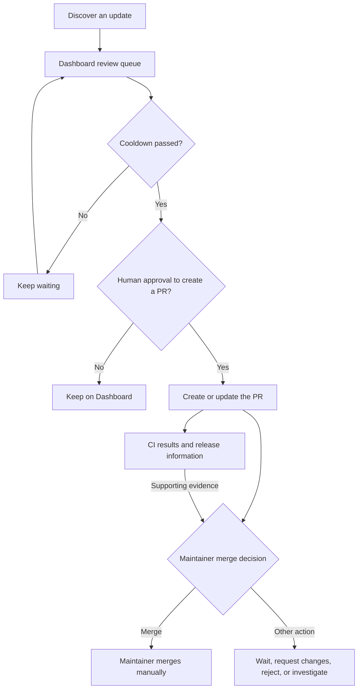

# Dependency update review

Use renodash output as evidence for the maintainer's dependency update decisions.
Preserve the release cooldown, Dashboard approval before ordinary-update pull request (PR) creation, and a human decision to merge.
Successful continuous integration (CI), release age, and no matching advisories do not establish that an update is safe.

Renovate manages updates and PRs. renodash currently extracts Dashboard data and can fetch linked PR metadata.
Vulnerability assessment is outside the current CLI. No assessment interface or publication destination has been adopted.
See [Usage](usage.md) for supported commands.

## Review policy

New releases may contain malicious changes or defects. Keep these safeguards separate:

| Stage | Policy | Purpose |
| --- | --- | --- |
| Release cooldown | Wait about 14 days using Renovate's `minimumReleaseAge`. Keep strict internal checks for ordinary updates. | Reduce exposure to newly published releases. |
| Before ordinary-update PR creation | Require human approval in the Dependency Dashboard. | Decide whether an ordinary update should proceed to a branch and PR. |
| Before merging | The maintainer decides whether to merge and manually merges the PR. The diff, CI results, release notes, and available vulnerability evidence can support that decision. | Keep the merge decision and operation with the maintainer. |

Dashboard approval does not permit automatic merging. A passing CI check does not approve either stage.
An advisory report must not automatically approve, block, or merge a PR, or bypass the cooldown.

If a security exception is needed, document its benefits, risks, and alternatives for a separate human decision.
Do not shorten the cooldown merely to make reporting or update automation easier.

## Repository merge policy and enforcement

This repository is maintained by one person.
The maintainer may also be the contributor, including when changes are generated with Codex.

The maintainer decides whether to merge and manually merges the PR.
A separate manual review step and independent peer review are not required.

### Current repository controls

The following settings reflect the maintainer-confirmed state as of 2026-11-14.
Update this section when changing the settings.

The active [GitHub ruleset for `main`](https://github.com/gkzz/renodash/rules/26218115) targets the default branch, currently `main`.
It requires changes to go through a PR and has no configured bypass actors.
It requires zero approving reviews.
GitHub auto-merge and [Renovate automerge](https://github.com/gkzz/renovate-config/blob/main/renovate.json5) are disabled and must remain disabled.

GitHub enforces the PR workflow, but does not require approval by another reviewer.
The decision to merge and the manual merge operation remain the maintainer's responsibility.

Required CI status checks are not configured.
CI results support the merge decision, but GitHub does not require those checks to pass before merging.
The maintainer does not configure required checks or manage individual check names.
CI results and vulnerability information are supporting evidence, not separate mandatory approval gates.

Dependency Dashboard approval before PR creation remains distinct from the decision to merge.
Neither stage is automatically approved by a passing CI check or a vulnerability report.

## Review flow

The diagram separates Dashboard approval from the maintainer's merge decision.
CI and release information support that decision.

CI and release information support the decision; successful checks are not a prerequisite for merging.
This diagram describes the intended ordinary-update policy, not every Renovate execution path.
Dashboard display order and scheduling can differ. Security updates and explicit waiting-period overrides need separate consideration.

## Renovate controls and exceptions

The [shared Renovate configuration](https://github.com/gkzz/renovate-config) owns the operational settings.
Check the effective configuration and running Renovate version when investigating a particular update.

| Control | What to check |
| --- | --- |
| `minimumReleaseAge` | The configured waiting period and the datasource's release timestamp. |
| `minimumReleaseAgeBehaviour` | Whether a missing timestamp keeps a release pending. Defaults can differ between Renovate versions. |
| `internalChecksFilter` | With `strict`, pending age checks normally prevent a new branch and therefore a PR. Check explicit Dashboard overrides. |
| `dependencyDashboardApproval` | Approval before creating an ordinary update branch. Do not assume every later change to an existing PR requires another approval. |
| `vulnerabilityAlerts` | GitHub alert-driven fix PRs and their effective settings. These can override ordinary cooldown and Dashboard approval settings. |
| `osvVulnerabilityAlerts` | Whether the experimental feature is enabled and supports the exact datasource and product. |
| `automerge` | Check update-specific overrides against the [repository merge policy](#repository-merge-policy-and-enforcement). |
| GitHub merge rules | See [current repository controls](#current-repository-controls) for the PR requirement, zero required approvals, and no required CI checks. |

Renovate's default vulnerability-fix settings remove the release cooldown and Dashboard approval gate.
A security label in release notes alone does not establish that an update entered that path.
Check the alert source, product mapping, effective settings, and logs before describing the behavior.

See Renovate's [release-age guide](https://docs.renovatebot.com/key-concepts/minimum-release-age/) and [configuration reference](https://docs.renovatebot.com/configuration-options/).
Document any mismatch with project policy before proposing a configuration change.

## Assessment scope

Any future assessment should use existing tools or official APIs for supported products and versions.
Verify the exact product, distribution, ecosystem, and version identity before choosing a source.
Do not infer support from a similarly named package.

Assess current and proposed versions separately, preserving source limitations and unknown results.
Preserve confirmed matches alongside unresolved limitations.
A missing match does not establish safety, and a failed query must not become a successful no-match result.
Keep the evaluated revision, source scope, and check time with the evidence.
Implementation, integration, and publication choices remain open.

## Public reporting boundaries

Keep actual dependency assessment results in a destination with verified access controls.
Do not publish repository-specific dependency/advisory associations in public logs, Job Summaries, artifacts, PR comments, or issues.
A publicly disclosed advisory does not make its association with a repository suitable for publication.
Review stdout, stderr, error messages, and uploaded files as well as the Summary.

Do not expose actual assessment states or match counts through public check conclusions or job names.
Separate operational success from assessment findings.

Use synthetic packages, versions, advisory identifiers, and results for public workflow experiments.
Label them as fixtures that do not assess the repository's actual dependencies or deployment.
Real-source verification requires a separate decision about its targets and output visibility.

Keep public documentation focused on reusable policy and tool capabilities.
Record repository-specific findings only where the intended audience and access controls have been verified.
