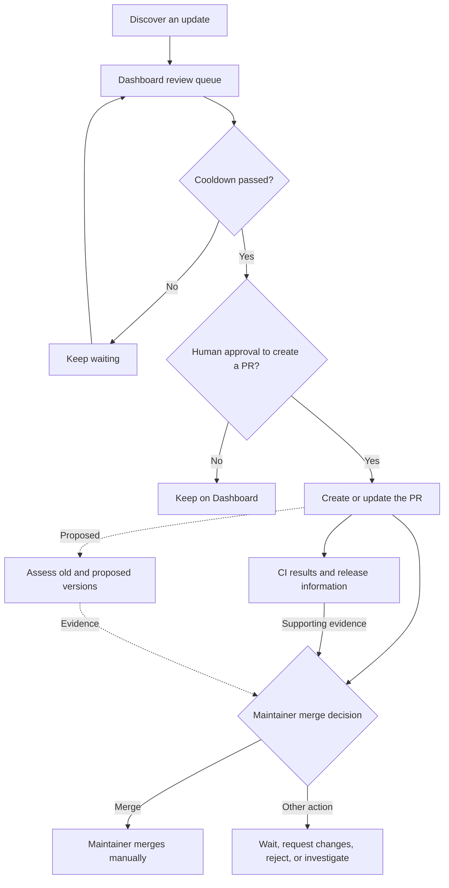

# Dependency update review

Use renodash output as evidence for the maintainer's dependency update decisions.
Preserve the release cooldown, Dashboard approval before ordinary-update pull request (PR) creation, and a human decision to merge.
Successful continuous integration (CI), release age, and no matching advisories do not establish that an update is safe.

Renovate manages updates and PRs. renodash currently extracts Dashboard data and can fetch linked PR metadata.
Vulnerability reporting is a proposed capability, not an available command.
See [Usage](usage.md) for supported commands.

## Review policy

New releases may contain malicious changes or defects. Keep these safeguards separate:

| Stage | Policy | Purpose |
| --- | --- | --- |
| Release cooldown | Wait about 14 days using Renovate's `minimumReleaseAge`. Keep strict internal checks for ordinary updates. | Reduce exposure to newly published releases. |
| Before ordinary-update PR creation | Require human approval in the Dependency Dashboard. | Decide whether an ordinary update should proceed to a branch and PR. |
| Before merging | The maintainer decides whether to merge and manually merges the PR. The diff, CI results, release notes, and available vulnerability evidence can support that decision. | Keep the merge decision and operation with the maintainer. |

Dashboard approval does not permit automatic merging. A passing CI check does not approve either stage.
An advisory report must not automatically approve, block, or merge a PR, or bypass the cooldown.

If a security exception is needed, document its benefits, risks, and alternatives for a separate human decision.
Do not shorten the cooldown merely to make reporting or update automation easier.

## Repository merge policy and enforcement

This repository is maintained by one person.
The maintainer may also be the contributor, including when changes are generated with Codex.

The maintainer decides whether to merge and manually merges the PR.
A separate manual review step and independent peer review are not required.

### Current repository controls

The following settings reflect the maintainer-confirmed state as of 2026-11-14.
Update this section when changing the settings.

The active [GitHub ruleset for `main`](https://github.com/gkzz/renodash/rules/26218115) targets the default branch, currently `main`.
It requires changes to go through a PR and has no configured bypass actors.
It requires zero approving reviews.
GitHub auto-merge and [Renovate automerge](https://github.com/gkzz/renovate-config/blob/main/renovate.json5) are disabled and must remain disabled.

GitHub enforces the PR workflow, but does not require approval by another reviewer.
The decision to merge and the manual merge operation remain the maintainer's responsibility.

Required CI status checks are not configured.
CI results support the merge decision, but GitHub does not require those checks to pass before merging.
The maintainer does not configure required checks or manage individual check names.
CI results and vulnerability information are supporting evidence, not separate mandatory approval gates.

Dependency Dashboard approval before PR creation remains distinct from the decision to merge.
Neither stage is automatically approved by a passing CI check or a vulnerability report.

## Review flow

The diagram separates Dashboard approval from the merge decision. The dotted path describes proposed vulnerability reporting.
That report helps the maintainer decide whether to wait, request another version, reject the update, investigate, or merge it manually.



CI and release information support the decision; successful checks are not a prerequisite for merging.
This diagram describes the intended ordinary-update policy, not every Renovate execution path.
Dashboard display order and scheduling can differ. Security updates and explicit waiting-period overrides need separate consideration.

## Renovate controls and exceptions

The [shared Renovate configuration](https://github.com/gkzz/renovate-config) owns the operational settings.
Check the effective configuration and running Renovate version when investigating a particular update.

| Control | What to check |
| --- | --- |
| `minimumReleaseAge` | The configured waiting period and the datasource's release timestamp. |
| `minimumReleaseAgeBehaviour` | Whether a missing timestamp keeps a release pending. Defaults can differ between Renovate versions. |
| `internalChecksFilter` | With `strict`, pending age checks normally prevent a new branch and therefore a PR. Check explicit Dashboard overrides. |
| `dependencyDashboardApproval` | Approval before creating an ordinary update branch. Do not assume every later change to an existing PR requires another approval. |
| `vulnerabilityAlerts` | GitHub alert-driven fix PRs and their effective settings. These can override ordinary cooldown and Dashboard approval settings. |
| `osvVulnerabilityAlerts` | Whether the experimental feature is enabled and supports the exact datasource and product. |
| `automerge` | Check update-specific overrides against the [repository merge policy](#repository-merge-policy-and-enforcement). |
| GitHub merge rules | See [current repository controls](#current-repository-controls) for the PR requirement, zero required approvals, and no required CI checks. |

Renovate's default vulnerability-fix settings remove the release cooldown and Dashboard approval gate.
A security label in release notes alone does not establish that an update entered that path.
Check the alert source, product mapping, effective settings, and logs before describing the behavior.

See Renovate's [release-age guide](https://docs.renovatebot.com/key-concepts/minimum-release-age/) and [configuration reference](https://docs.renovatebot.com/configuration-options/).
Document any mismatch with project policy before proposing a configuration change.

## Evidence for vulnerability reports

The following are design constraints for proposed vulnerability reporting.
They do not define a new CLI or JSON schema.

Identify the product, distribution, ecosystem, and versions from the PR changes.
Do not replace the official Node.js runtime with similarly named npm or distribution packages without evidence that their identities match.
A lockfile can reference different distributions on different platforms; record which artifacts the assessment covers.

Assess old and proposed versions separately against authoritative affected ranges.
Distinguish vulnerabilities fixed by the update from those remaining in its proposed version.

| Result | Meaning |
| --- | --- |
| `Affected` | A source confirms that the version falls within an advisory's affected range. |
| `NoMatchInCheckedSources` | No match was found within the sources and scope checked. |
| `Unknown` | Identity, affected ranges, coverage, or retrieval problems prevent assessment. Include the reason. |

Keep confirmed affected results visible when another source fails or has unclear data.
Report incomplete coverage alongside those matches. Never turn a retrieval failure into a no-match result.

A report should identify the PR head SHA, inspected files, product and distribution, versions, advisories, affected ranges, and fixed releases.
Include source links, UTC check time, unknowns, and items requiring human review.
If CI results are included, record their checked SHA and explain any mismatch with the PR head SHA.
CI aggregation remains optional until its cost and consistency rules are understood.

Treat a report as evidence for one commit at one time.
PR updates and newly published advisories require reassessment; earlier reports do not automatically cover them.
Read untrusted PR changes as data, use only necessary read permissions, and handle external text and URLs safely when rendering Markdown.

### Assessment pseudocode

This pseudocode illustrates design constraints rather than an adopted interface or executable code.
Collect source outcomes before combining them so a failed source cannot hide another source's confirmed match.

```text
assess(product, version, sources):
    if product identity or version is unknown:
        return Unknown("Cannot identify the target")
    matches = []
    limitations = []
    checked_sources = []

    for source in sources:
        if identity is unclear or source cannot assess this distribution:
            limitations.append(source, "Unsupported or unidentified target")
            continue
        outcome = fetch_and_compare_ranges(source, product, version)
        matches.extend(outcome.confirmed_matches)
        limitations.extend(outcome.retrieval_or_range_problems)
        checked_sources.extend(outcome.completed_checks)

    if matches exist:
        return Affected(matches, checked_sources, limitations)
    if limitations exist or checked_sources is empty:
        return Unknown(checked_sources, limitations)
    return NoMatchInCheckedSources(checked_sources)

old_result = assess(product, old_version, sources)
proposed_result = assess(product, proposed_version, sources)
report(old_result, proposed_result, evidence, pr_head_sha, checked_at_utc)
# Reporting does not automatically approve, block, or merge a PR.
```

Keep the evidence and source limitations visible for each version.
Use each source's affected-range rules; comparing with one latest fixed version is insufficient.

## Waiting for a security fix

An older update can pass the cooldown while a later security patch remains pending.
Report vulnerabilities remaining in the proposed version so a person can choose to wait or request another target.
Do not silently select a replacement version or approve a merge.

Waiting reduces exposure to new releases but can delay a known fix.
Faster adoption can reduce known vulnerability exposure while adding release risk.
Neither choice removes all risk. Record any exception as a separate human decision.

| Situation | Review response |
| --- | --- |
| An ordinary release is under 14 days old. | Keep waiting. Check timestamp evidence and explicit waiting-period overrides. |
| An older eligible target has a vulnerability; a newer fix is pending. | Show the remaining vulnerability. A person decides whether to wait, request another target, or reject the update. |
| Renovate recognizes a security update. | Check the effective cooldown and approval settings. Document any proposed exception for a separate decision. |
| An advisory appears after PR creation. | Reassess the current PR head and record the new check time. |
| An advisory source fails or its range is unclear. | Show the limitation as unknown and preserve any confirmed matches from other sources. |

Keep temporary investigation progress, verification records, and implementation tracking in GitHub issues.
Keep reusable assessment rules and source limitations in documentation.
Track implementation and configuration changes separately.
