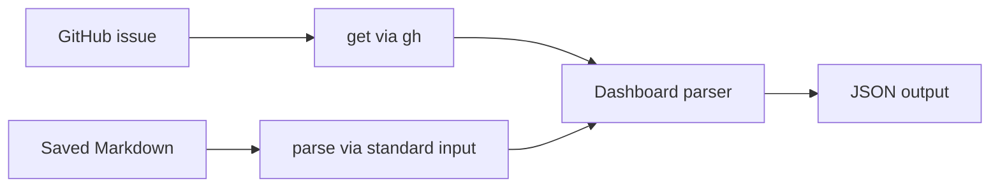

# Usage

renodash parses saved Markdown or fetches and parses a GitHub issue. See the [JSON and parsing reference](specs/internal/dashboard/output-format.md) for output fields and supported input.

## Choose a command

| Task | Command | Requirements |
| --- | --- | --- |
| Parse a saved Dashboard | `renodash parse < dashboard.md` | A local Markdown file; no network or authentication |
| Fetch and parse an issue | `renodash get OWNER/REPO#ISSUE_NUMBER` | GitHub CLI (`gh`), authentication, and issue read access |
| Include linked pull request (PR) states and checks | `renodash get --with-pr-metadata OWNER/REPO#ISSUE_NUMBER` | The `get` requirements, plus access to linked PR metadata and checks |

Replace `OWNER/REPO#ISSUE_NUMBER` with the Dashboard's repository and issue number.
Both commands extract information. They do not change checkboxes, create PRs, or apply updates.

The commands share a Dashboard parser. `get` fetches the issue body first; `parse` reads it from standard input.
Both write JSON, and only `get --with-pr-metadata` fetches linked PR states and checks.



## Installation

To install from source, use Go 1.27 or later and run this from the repository root:

```sh
go install .
```

The binary is installed in `GOBIN`, or `GOPATH/bin` if `GOBIN` is unset. The default is usually `$HOME/go/bin`. Add the appropriate directory to your `PATH`; use `go env GOBIN GOPATH` to check the configured paths.

To install v0.0.5 without checking out the repository, use the `cmd/renodash` package path:

```sh
go install github.com/gkzz/renodash/cmd/renodash@v0.0.5
renodash version
```

Releases through v0.0.5 use `cmd/renodash` as the CLI entry point. Starting with v0.0.6, the CLI entry point is the repository root:

```sh
go install github.com/gkzz/renodash@v0.0.6
renodash version
```

To install without Go, download the archive for your OS and CPU from [GitHub Releases](https://github.com/gkzz/renodash/releases), extract it, and place the binary on your `PATH`. Releases include a SHA-256 `checksums.txt` file.

## Fetch a GitHub issue

`get` requires GitHub CLI (`gh`) on your `PATH` and authentication with read access to the issue.

```sh
gh auth login
gh auth status
renodash get OWNER/REPO#ISSUE_NUMBER
```

`get` fetches the issue body through `gh api`. The `source` object records the issue URL, fetch time, and issue update time.

Add `--with-pr-metadata` to fetch the state and CI checks of PRs linked from the Dashboard:

```sh
renodash get --with-pr-metadata gkzz/renodash#5
```

The result includes a `pull_requests` array. Each linked PR in the same repository is fetched once.
PRs are fetched sequentially, so total runtime grows with the number of linked PRs.
See [request budgets](specs/internal/command/github-client.md#deadlines-and-cancellation) for timeouts and cancellation.
If a link is unsupported or a PR request fails, the command returns an error without writing JSON.
See [linked pull request metadata](specs/internal/dashboard/output-format.md#linked-pull-request-metadata) for fields and limits.

### GitHub Actions permissions

For `--with-pr-metadata`, start with these read permissions and set `GH_TOKEN` to `${{ github.token }}` in the step environment:

```yaml
permissions:
  contents: read
  issues: read
  pull-requests: read
  checks: read
  statuses: read
```

`issues` covers the Dashboard, `pull-requests` covers PR metadata, and `checks` and `statuses` cover the two kinds of CI results.
See GitHub's [workflow permissions reference](https://docs.github.com/en/actions/reference/workflows-and-actions/workflow-syntax#permissions).
A successful plain `get` does not verify access to PR checks.
The workflow token is scoped to its repository; use a token with access to the target repository for cross-repository requests.

This permission set has not yet been verified by this project in Actions against a private repository.
Before relying on it, run both commands below in the target repository's workflow with the permissions above:

```sh
renodash get OWNER/REPO#ISSUE_NUMBER > dashboard.json
renodash get --with-pr-metadata OWNER/REPO#ISSUE_NUMBER > dashboard-with-prs.json
```

Use a Dashboard with linked PRs that have both Actions checks and external commit statuses.
Verify that both commands succeed and that `pull_requests[].checks` contains the expected results.
Repeat in a private repository and record the run URL, repository visibility, permissions, and result.
If the second command fails, check token permissions and repository access before using its output.

### Filter candidates

With `jq`, you can display just the candidates:

```bash
set -o pipefail
renodash get OWNER/REPO#ISSUE_NUMBER | jq '.items[]'
```

Run this pipeline in Bash. `pipefail` makes a fetch or parse failure produce a nonzero pipeline exit code. Dashboards change over time and may have no candidates.

## Run in GitHub Actions

The [offline workflow](../.github/workflows/renodash.yml) tests the current PR's
renodash source with `go install .`. It runs only on pull requests when opened,
synchronized, reopened, or marked ready for review. It ignores only issue template
changes and `.github/pull_request_template.md`.

The workflow runs `get --with-pr-metadata` using the [offline process adapter](../testdata/pr-metadata/README.md#run-locally).
See that reference for fixture isolation and local execution.
No GitHub token is passed to the tested code. Checkout does not persist credentials,
and the workflow declares `permissions: {}`.

The Job Summary displays fixture candidates, PR states, and checks. Empty checks
are unknown, not success. PR metadata reflects fixture capture time, not current
GitHub state; `fetched_at` reflects test execution time. The workflow does not
perform live dependency review or make merge decisions. The `renodash-offline`
artifact stores the output JSON for 1 day.

For local fixture execution and summary rendering, see the [fixture instructions](../testdata/pr-metadata/README.md#run-locally).
The renderer labels input as saved snapshots, so use it only with offline fixture results.

Fixture refreshes are deliberate. Review their provenance, source URLs, capture
time, and captured versus synthetic data together. See the fixture README for
local execution and coverage limitations. Live review would require a separate
workflow that runs trusted code.

## Parse saved Markdown

`parse` reads Markdown from standard input. It needs neither a network connection nor GitHub authentication.
Run these examples from the repository root, where `testdata/renodash.md` is available:

```sh
renodash parse < testdata/renodash.md
renodash parse --format json < testdata/renodash.md
```

`--format` is optional; `json` is the only supported format. To run from source, use the following from the repository root:

```sh
go run . parse < testdata/renodash.md
```

The shell's `<` operator sends the file contents to standard input. It does not pass the filename as an argument.
The saved fixture produces five items, including a repeated PR link. Its `bulk_actions` and `unknown_controls` arrays are empty.
For example, the second entry in `items` is:

```json
{
  "action": "rebase",
  "branch": "renovate/fixture-51",
  "title": "[chore(deps): update toolchain](../pull/51)",
  "section": "Open",
  "checked": false,
  "pr_link": "../pull/51"
}
```

This is one item, not the complete output. `checked: false` records the unchecked box in the input.
`action: "rebase"` describes the Dashboard control; parsing does not perform a rebase.
The fixture is saved test data, not a report of current GitHub state.

### Output and exit codes

See [output conventions](specs/internal/dashboard/output-format.md#output-conventions) for JSON output, diagnostics, and exit codes.

## Troubleshooting

| Symptom | What to check |
| --- | --- |
| `renodash` is not found | Check that the installation directory is on your `PATH`. |
| `get` fails to fetch the issue | Check the `gh` installation, `gh auth status`, the issue reference, and read permissions. |
| `items` is empty | Check whether the Dashboard has candidates in a [supported section](specs/internal/dashboard/output-format.md#supported-controls-and-sections). |
| An unsupported-control warning appears | Inspect `unknown_controls` and the original body. Do not treat an unknown control as a supported action. |
| Expected `research` is missing | Check `renodash version` and the [supported title formats](specs/internal/dashboard/output-format.md#research-context-for-agents). |

Do not use output from a failed command for research. Resolve the error reported on standard error, then rerun the command. Saved Markdown can be parsed again with `parse`.

Command help is also available:

```sh
renodash --help
renodash parse --help
renodash get --help
```

## Check the version

```sh
renodash version
go run . version
```

Run `go run . version` from the repository root. The command needs no standard input, makes no network requests, and changes no files.

See [build information](development.md#build-information) for how the version, commit SHA, and `dirty` marker are determined.
